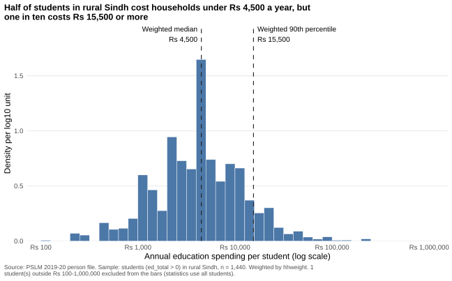
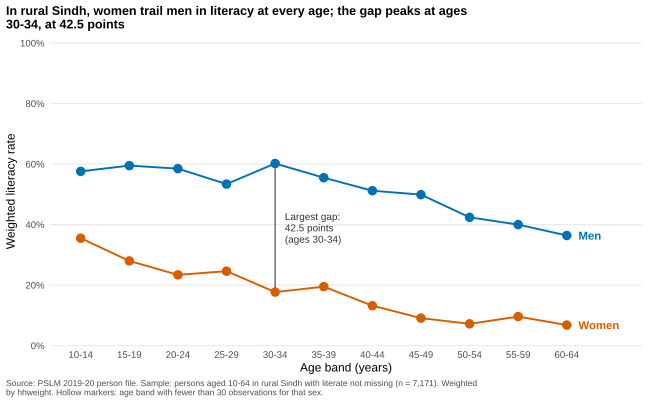

# ECO346-A1-FA24-BEDS-066

ECO346 Data Visualization Techniques for Economists, Assignment 1, Fall 2026 (Section B).
Registration number: FA24-BEDS-066.

## Variant

66 = 8 x 8 + 2, so **variant 2: Sindh, rural** (`prov_code == 3`, `urban_rural == 1`).
Data: PSLM 2019-20 person file, with `hhweight`, `prov_code` and `urban_rural` attached from the household file by `hhid`. Every statistic is weighted by `hhweight`.

## How to reproduce

From a fresh clone, with no internet needed (R with `ggplot2`, `dplyr`, `readr`, `tidyr`, `svglite`; Python with `pandas`, `numpy`, `matplotlib`):

```
Rscript scripts/01_default.R
Rscript scripts/02_distribution.R
Rscript scripts/03_relationship.R
python scripts/04_python_check.py
```

| Script | Output |
|---|---|
| `scripts/01_default.R` | `figures/default.svg` |
| `scripts/02_distribution.R` | `figures/distribution.svg`, `output/q2_numbers_R.txt` |
| `scripts/03_relationship.R` | `figures/literacy_by_age.svg`, `output/band_table_R.csv` |
| `scripts/04_python_check.py` | `figures/literacy_by_age_python.svg`, `output/band_table_py.csv` |

Slides: `slides/FA24-BEDS-066.pptx`.

## Question 2: the distribution



| Quantity | Value |
|---|---|
| Students (`ed_total > 0`) | 1,440 |
| Weighted median | Rs 4,500 |
| Unweighted median | Rs 4,295 |
| Weighted 10th percentile | Rs 1,000 |
| Weighted 90th percentile | Rs 15,500 |
| 90th / 10th ratio | 15.50 |
| Excluded (outside Rs 100 to Rs 1,000,000) | 1 |

Statistics use all 1,440 students; the one excluded student (Rs 6) is dropped from the histogram only.

**Interpretation.** In rural Sindh, spending per student is spread over about two orders of magnitude, centred near Rs 4,500, with a long right tail: the 90th percentile is 15.5 times the 10th. The weighted median (Rs 4,500) is slightly above the unweighted (Rs 4,295) because students in higher-weight households spend a little more, and many families report the round figure Rs 4,500, so the weighted median lands on it. The difference is small.

## Question 3: the relationship



Sample: 7,171 persons aged 10-64 with `literate` not missing. No band has fewer than 30 observations for either sex, so no marker is hollow.

| Band | Women: n | Women: literacy % | Men: n | Men: literacy % |
|---|---|---|---|---|
| 10-14 | 529 | 35.5 | 718 | 57.6 |
| 15-19 | 446 | 28 | 548 | 59.5 |
| 20-24 | 455 | 23.4 | 422 | 58.5 |
| 25-29 | 430 | 24.6 | 419 | 53.4 |
| 30-34 | 399 | 17.7 | 382 | 60.2 |
| 35-39 | 319 | 19.5 | 391 | 55.5 |
| 40-44 | 285 | 13.2 | 274 | 51.2 |
| 45-49 | 198 | 9.1 | 221 | 49.9 |
| 50-54 | 152 | 7.2 | 208 | 42.4 |
| 55-59 | 98 | 9.6 | 100 | 40 |
| 60-64 | 77 | 6.8 | 100 | 36.4 |

- Women aged 15-19: 28.0%; men aged 15-19: 59.5%.
- Women aged 55-59: 9.6%; men aged 55-59: 40.0%.
- Largest gap: ages 30-34 (42.5 percentage points).

**Interpretation.** Literacy is lower in older bands for both sexes, and women trail men in every band. Women fall from 35.5% at ages 10-14 to 6.8% at 60-64; men from about 58% to 36%. The gap peaks at 42.5 points at ages 30-34. An economist would read this as unequal access to schooling across birth cohorts, with the youngest gap (22.1 points) hinting at some catching up. It cannot tell us whether this is an age effect or a cohort effect, because it is one cross-section.

## Question 4: the makeover

Default (`figures/default.svg`, committed before the redesign):


**Explanation.** Three changes. First, the default overplots thousands of 0/1 points on two lines; plotting a weighted mean per band shows the conditional means, the pattern the dots hide. Second, position along a common scale, two colours and direct end labels replace dots that need a reader to guess the trend, following the perceptual ranking of channels and lowering lookup effort. Third, I removed the grey panel and extra grid lines (data-ink) and set a 0-100% axis with a finding title and a caption. The default shows individual single-year ages and that every age contains both literate and illiterate persons; the redesign hides that within-band variation.

## Question 5: a second language (Python)

Python recomputes the band table (`output/band_table_py.csv`) and redraws the figure (`figures/literacy_by_age_python.svg`). The two tables agree to one decimal place (the script checks this and prints the result).

Literacy rate of women aged 15-19: **28.0% in R, 28.0% in Python**.

**What differed.** ggplot2 adds 5% padding to both axes by default, while matplotlib uses its own margins, so the plots would have different axis extents. I set explicit limits in matplotlib (x 10-68, y 0-100) and hid spines and ticks so the figures match. The band tables needed no adjustment and agree to one decimal.

## Weighted quantile definition

Sort by value, take the cumulative share of `hhweight`, and use the smallest value where the share reaches or exceeds p (not R's `quantile()`).
